<p align="center">
  
</p>

<h1 align="center">BOVI</h1>

<p align="center">
  A planner for college students and their own projects, built around one universal calendar.<br/>
  Android app · Expo SDK 58 · React Native 0.88 · TypeScript · local-first (no accounts, no servers)
</p>

<p align="center">
  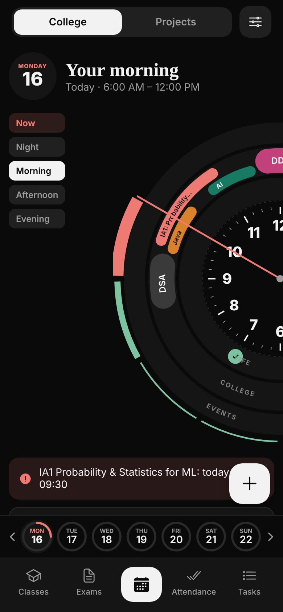
  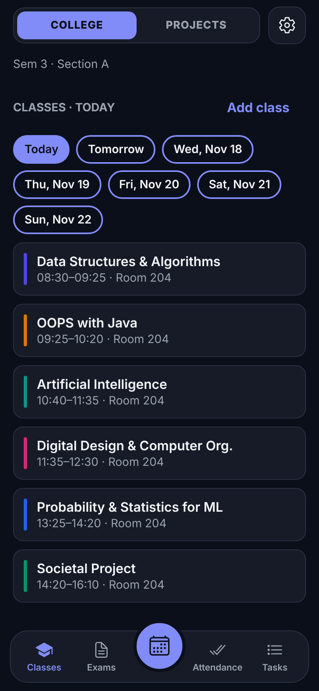
  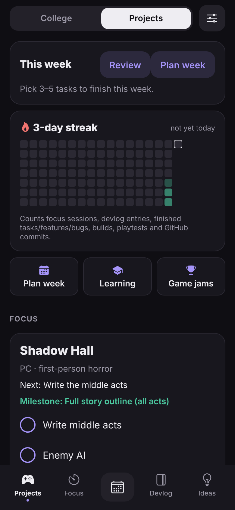
</p>

<p align="center"><b>Build · Organize · Visualize · Improve</b></p>

<p align="center">
  <a href="https://krishkumarravidas.github.io/BOVI-Build-Organize-Visualize-Improve/"><b>Website</b></a> ·
  <a href="../../releases/latest"><b>Download the APK</b></a>
</p>

## Download

**[Get the latest APK from Releases](../../releases/latest)**: open it on your Android phone, allow *Install unknown apps* if asked, and follow the short setup. No account needed; everything stays on your phone.

Prefer to build it yourself? See [Install on your Android phone](#install-on-your-android-phone).

---

## Contents

- [Getting started (first launch)](#getting-started-first-launch)
- [Import your attendance](#import-your-attendance)
- [How the app is organised](#how-the-app-is-organised)
- [Features](#features)
  - [Universal calendar](#universal-calendar)
  - [College mode](#college-mode)
  - [Projects tab (your own name)](#projects-tab-your-own-name)
  - [Habits, schedule blocks and reminders](#habits-schedule-blocks-and-reminders)
  - [Screen time](#screen-time)
  - [Insights](#insights)
  - [Home-screen widgets](#home-screen-widgets)
  - [Backup and restore](#backup-and-restore)
- [Connect to Claude](#connect-to-claude)
- [Screenshots](#screenshots)
- [Install on your Android phone](#install-on-your-android-phone)
- [Troubleshooting the Windows build](#troubleshooting-the-windows-build)
- [Development](#development)
- [Project structure](#project-structure)
- [Data and privacy](#data-and-privacy)
- [Known limitations](#known-limitations)

---

## Getting started (first launch)

BOVI starts empty: no account, no sample data, nothing uploaded. On first launch a short **setup** walks you through it (every step can be skipped and changed later in *Settings → Run setup again*):

1. **Your college:** course and section, your usual classroom, and your subjects (name, short name, optional course code).
2. **Attendance (optional):** import your official attendance from the college portal (see below).
3. **Your second tab:** the tab next to *College* is for your own stuff: projects, focus timer, devlog, ideas. Call it *Projects*, *Game dev*, *Side projects*, *Work*… or anything you like. You can rename it any time in Settings.
4. **Reminders:** allow notifications and pick a morning-briefing time.

Then add your weekly timetable in *Classes → Timetable*.

| | | |
|:-:|:-:|:-:|
| 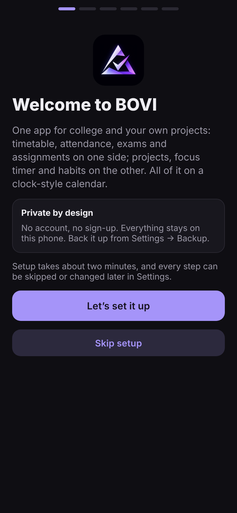<br/>Setup | 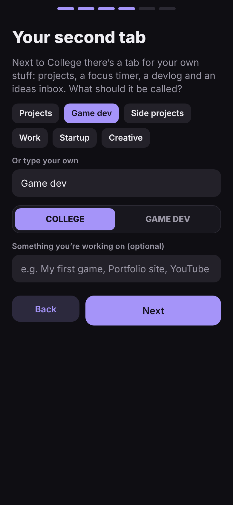<br/>Name your second tab | 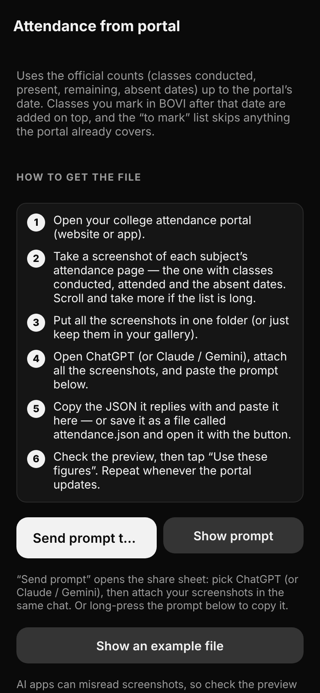<br/>Attendance import |

## Import your attendance

BOVI can use the official numbers from your college attendance portal (classes conducted, attended, remaining and the dates you were absent). Classes you mark in BOVI after the portal's date are added on top.

1. Open your college attendance portal (website or app).
2. **Screenshot each subject's attendance page**, the one with classes conducted and attended and the absent dates. Take more screenshots if the list scrolls.
3. Put the screenshots in one folder, or keep them in your gallery.
4. Open **ChatGPT** (or Claude / Gemini), attach all the screenshots and paste the prompt below. In BOVI, *Attendance → Update from portal → Send prompt to AI app* sends this prompt straight into the app for you.
5. Copy the JSON it replies with and paste it into BOVI, or save it as `attendance.json` and tap *Open attendance file*.
6. Check the preview against your portal (AI apps can misread a screenshot), then tap **Use these figures**. Repeat whenever the portal updates.

Subjects are matched by course code (then by name). Subjects that don't exist yet are created for you.

<details>
<summary><b>The prompt</b> (copy into ChatGPT together with your screenshots)</summary>

```text
I'm attaching screenshots of my college attendance portal, one or more per subject.
Read every screenshot and give me ONE JSON file in exactly this format, and nothing else:

{
  "source": "College attendance portal screenshots",
  "generated_on": "YYYY-MM-DD",
  "subjects": [
    {
      "subject_code": "course code as shown, e.g. CS305",
      "subject_name": "full subject name as shown",
      "faculty": "teacher's name if shown, otherwise leave this field out",
      "classes_conducted": 0,
      "classes_present": 0,
      "classes_absent": 0,
      "classes_remaining": 0,
      "attendance_percent": 0.0,
      "absent_records": [
        { "date": "YYYY-MM-DD", "time": "HH:MM-HH:MM" }
      ]
    }
  ]
}

Rules:
- "generated_on" is the "last updated" date shown on the portal (or today's date if none is shown).
- One entry per subject (labs are separate subjects). Don't merge or skip any.
- Numbers must be plain numbers, copied exactly from the screenshots. Don't calculate or guess.
- Leave out "classes_remaining" if the portal doesn't show it.
- List every absent class you can see in "absent_records", with dates as YYYY-MM-DD and 24-hour times. Use an empty list if none are shown.
- Reply with only the JSON (no explanation), so I can save it as attendance.json.
```
</details>

<details>
<summary><b>Example file</b></summary>

```json
{
  "source": "College attendance portal screenshots",
  "generated_on": "2026-11-19",
  "subjects": [
    {
      "subject_code": "CS305",
      "subject_name": "Data Structures and Algorithms",
      "faculty": "Prof. A. Example",
      "classes_conducted": 25,
      "classes_present": 20,
      "classes_absent": 5,
      "classes_remaining": 24,
      "attendance_percent": 80,
      "absent_records": [
        {
          "date": "2026-11-04",
          "time": "10:40-11:35"
        },
        {
          "date": "2026-10-21",
          "time": "09:25-10:20"
        }
      ]
    },
    {
      "subject_code": "CSL306",
      "subject_name": "Data Structures Laboratory",
      "classes_conducted": 8,
      "classes_present": 7,
      "classes_absent": 1,
      "classes_remaining": 26,
      "attendance_percent": 87.5,
      "absent_records": [
        {
          "date": "2026-10-09",
          "time": "08:30-10:20"
        }
      ]
    }
  ]
}
```
</details>

---

## How the app is organised

```
┌──────────────────────────────────────┐
│  [ COLLEGE | PROJECTS ]          ⚙   │  ← mode switch · settings & more
│                                      │
│            screen content            │
│                                      │
│  [tab] [tab]   ( 📅 )   [tab] [tab]  │  ← 2 mode tabs · calendar · 2 mode tabs
└──────────────────────────────────────┘
```

| | Left tabs | Centre | Right tabs |
|---|---|---|---|
| **College** | Classes · Exams | **Calendar** (universal) | Attendance · Tasks |
| **Projects** (you name it) | Projects · Focus | **Calendar** (universal) | Devlog · Ideas |

- The **calendar is the same in both modes**. The switch only changes the four side tabs.
- Switching modes keeps your position: from **Exams** (college tab 2) you land on **Focus** (projects tab 2).
- **⚙** opens the hub for Habits, Schedule blocks, Screen time, Insights, Backup, and settings (theme, reminders, which calendars to show).

---

## Features

### Universal calendar

A clock-style view of your day, inspired by radial planners.

- **Half clock dial** anchored to the right edge. The visible half covers **6 hours**, titled *"Your morning"*, *"Your afternoon"* and so on.
- **Rotate it:** drag around the dial to spin through the day, like turning a real clock. Clockwise goes back in time, anticlockwise forward, and it snaps to the nearest 15 minutes when you let go. Hour numbers, ticks and arcs all move with it. **Keep turning past midnight and it carries on into the next (or previous) day**: the date at the top changes, and midnight is marked with the day's name. Touching the rings rotates the dial; touching anywhere else scrolls the page. A tap without moving opens (or ticks) whatever is under your finger.
- Today opens with **now in the middle**. Chips on the left animate the dial to **Now**, Night (0–6), Morning (6–12), Afternoon (12–18) or Evening (18–24).
- **Three rings**, inside to outside:
  - **LIFE:** schedule blocks (gym, sleep…), **timed tasks**, and **habits as dots** you tap to tick.
  - **COLLEGE:** classes (in subject colours), exams (red) and revision sessions (teal).
  - **EVENTS:** events from the calendars on your phone, including Google Calendar.
- Items are **arcs sized by duration**, with labels curving along them. Overlapping items share a ring side by side, and overlaps are outlined in red.
- **Phone use per hour** shows as ticks around the outer edge (red for 30+ minutes in an hour).
- A **red hand** shows the current time.
- **Tasks:** one-off things to do on a day. Type one into **+ Add a task** in the to-do list, or use the clock button (or **+ → Task**) to give it a time, a length (15 min – 2 h) and a reminder. Timed tasks sit on the LIFE ring; tap to tick, long-press to edit. Unfinished untimed tasks carry over to today (marked with their original day) instead of disappearing, and open tasks appear in the morning briefing.
- Below the dial: an **exam banner** (within 3 days), a **to-do list** (tasks, untimed habits, assignments due, all-day events, project items due), and a readable **list of everything in the period** (tap to open or tick).
- Bottom row: the **week's days, each ringed by that day's progress** (habits, revision and assignments done). Arrows change week.
- **+ button:** add a task, a habit, a one-off class, an assignment, an exam, a schedule block, a project, a devlog entry or an idea.

### College mode

**Classes**
- Today's classes (or your next college day on weekends) with a 7-day picker.
- Tap a class to **change it for that day only**: edit time or room, **move it to another day**, **cancel** or **restore** it, or mark **Present / Absent**.
- **Add a one-off class** (extra lecture, rescheduled lab, doubt session) on any date.
- Badges for *Changed*, *Extra*, *Cancelled* and *Overlaps* (when a change makes two classes collide).
- Manage the **weekly timetable** (applies every week), **subjects** (name, short name, code, colour), course name, default classroom, **events & clubs**, and **marks**.

**Subject links**
- Save **Drive folders, Google Docs/Sheets/Slides, Classroom, lab manuals, PDFs, YouTube playlists** or any web link on a subject (Subjects → tap a subject → *+ Add link*). Paste the link; the title fills in by itself (e.g. *Drive folder*, *Google Doc*) or you can name it.
- They show on **every class of that subject** and as **Study links** on its exams. One tap opens them in the Drive / Docs / YouTube app if it's installed, otherwise in the browser. Long-press to share.

**Exams**
- Upcoming exams with **countdowns**, portions, and **clash warnings** (club events on the same day, overlapping exams).
- Per exam: a **syllabus checklist** with progress, and a **revision planner** that picks free slots before the exam (weekday evenings, weekend days) around classes, blocks, calendar events, other exams and existing sessions, then adds them to the calendar.
- **Marks & grades:** enter IA/lab marks per subject and see the **final-exam score you need** for a target %. The scheme is editable (internal weight, final max, target).
- **Reminders:** 8 PM the evening before (with time, portions and clashes) and 1 hour before (07:30 if the time isn't announced yet).

**Semesters**
- Give the semester a **name and dates**. Classes only appear between them, on the calendar, attendance, widgets and reminders.
- **Start a new semester** (Classes → Semester): the current one is saved whole (subjects, timetable, attendance, exams, marks), and you start fresh, optionally keeping the same subjects and timetable.
- **Switch** to any saved semester to look back or fix something, then switch back. Tasks, habits and projects aren't per-semester.

**Attendance**
- Overall and **per-subject %** against your minimum (65/75/80/85%).
- Tells you how many classes you **can miss**, or how many you **must attend in a row** to get back above the line.
- **Day by day:** a month calendar showing which days you were present, absent or missed some classes, from your own marks and the portal's absence dates. Tap a day to see each class and mark or change it. Filter by subject.
- **Stats:** current and best attendance streak, this month's %, the weekday you miss most, perfect days, and an 8-week trend against your target.
- Each subject shows a bar to the target and its **last 12 classes** (filled = present, hollow = absent), plus the dates of every absence.
- A **catch-up list** of the last 7 days' unmarked classes with one-tap Present / Absent. Cancelled classes don't count.

**Tasks**
- **Assignments** with subject, due date and notes. Overdue ones are flagged, they show on the calendar's to-do list on the due day, and you get a **reminder the evening before**.

### Projects tab (your own name)

The second tab set is called **Projects** by default; rename it in setup or *Settings → Second tab* (e.g. *Game dev*, *Work*). The game-making tools below (playtests, Steam launch, jams) are there if you need them and stay out of the way if you don't.

**Projects**
- A board grouped by status: *Active*, *Long-term*, *Planned*, *Concept*, *Paused*, *To decide*, *Parked*, *Done*.
- Your **active project** is pinned as *Focus*, with its next step, next milestone and tickable tasks.
- Per project: summary, next step, date, notes, **task checklist**, **milestones** (in roadmap order, with optional target dates) and a **devlog**.
- **Project links:** GitHub repo, Drive folder, design docs, Figma, itch.io / Steam page… Paste a GitHub link and it's titled *you/repo* automatically. The active project's links appear as one-tap chips on the Focus card, and they open in the GitHub app if it's installed.

**Project workspace** (open a project → *Workspace* tiles)
- **Scope:** features tagged **Must / Should / Could / Cut** with a size (S ≈ 4 h, M ≈ 12 h, L ≈ 30 h). Set a deadline and it checks the hours left against **your real pace** (focus hours over the last 4 weeks; 6 h/week assumed until there's data). If it doesn't fit, it names the **Could, then Should, features to cut**. Also shows things finished and focus hours per week for 8 weeks, plus a **forecast** for when the Musts land. A one-tap **vertical-slice template** adds the standard slice milestones.
- **Bugs:** title, severity (crash/high/medium/low), steps to reproduce and a **screenshot**. Open bugs are listed first by severity, with one tap to mark fixed.
- **Playtests:** tester, build, fun ★1–5, and **where they got scared / confused / bored**, collected into one view (made for horror).
- **Builds:** versions auto-bump (0.3.1 → 0.3.2) and the **changelog writes itself** from milestones ★, features +, tasks • and bug fixes since the last build. Optional download link; share the notes.
- **Assets:** Fab/Marketplace/Quixel/… purchases with licence, creator, cost (₹) and **used / not used yet**, showing totals and unused spend. **Share credits list** formats the used ones.
- **References:** a mood board (mood, lighting, monster, level, UI) from your photos, stored inside BOVI.
- **Steam launch:** set a release date and ~20 steps get typical dates counted back from it: Steam Direct, capsule art sizes, Coming Soon page, demo, **Next Fest**, creator outreach, pricing, build review, keys, launch day and first patch. Overdue steps turn red, any date can be changed, and steps show on the calendar's to-do list with a 9 AM reminder. **Wishlists:** log Steamworks numbers weekly to see the chart, weekly growth, % of goal (default 7,000) and weeks to goal.
- **Commits:** recent commits from the project's GitHub repo link (public repos need nothing; for private ones add a read-only token, which stays on the phone and is **never in backups**). Commit days count towards your streak.

**Projects tab extras**
- **This week:** pick 3–5 tasks across projects (*Plan week*). A Sunday 6 PM reminder nudges you if next week is empty, and the projects widget shows *week 2/5*.
- **Streak and heatmap:** a GitHub-style 17-week grid of active days (focus, devlog, finished tasks/features/bugs, builds, playtests, commits), your streak, and a nudge like *"3 days without touching My Game"*.
- **Learning queue:** courses and tutorials per project (*Up next → Learning now → Done*), plus a note on where you applied each one.
- **Game jams:** add a jam (start time, 24/48/72 h or a week) for a countdown on the Projects tab, a **phase plan** (brainstorm → prototype → rest → content → polish → submit → buffer), **scope limits**, the theme, and reminders at the theme reveal, a 30% scope check and 2 hours left.

**Focus**
- **Session notes:** say what you'll do before starting (one tap reuses the project's next step). Afterwards, BOVI asks *what happened* and *what's next*. That becomes a **devlog entry** and the project's new next step, so the next session starts where you left off.
- A **Pomodoro-style timer** (25/50/90 min) tied to a project.
- It keeps running if you close the app, notifies you when time's up, and **saves automatically** when the session ends. Stopping early saves the time spent (rounded, 30 s minimum), and a confirmation shows what was saved.
- **This week's focus** by day and by project, plus recent sessions.

**Devlog**
- A quick daily entry per project, with one feed across all projects.
- **Share week** turns the last 7 days into a markdown devlog draft (dates, bullet points, milestones done, next milestone) through Android's share sheet.

**Ideas**
- An inbox for ideas you don't want to start yet (one active project at a time).
- **Make project** turns an idea into a *Concept* project.

### Habits, schedule blocks and reminders

- **Habits:** pick days and an optional reminder time, see streaks (current and best) and history. Timed habits appear as dots on the dial; untimed ones go in the to-do list.
- **Schedule blocks:** recurring time like gym, sleep or study, with overnight support (23:00–07:00 shows "From 11 PM" and "Until 7 AM"), and an optional reminder at the start.
- **Reminders** run on-device through Android notifications: habits, blocks, exams, assignments and focus-session end. One switch turns them all off. Exam and assignment reminders have their own switch.

### Screen time

- Today's total, **top apps**, a **7-day chart**, and an optional **daily limit** (1–6 h) with an over-limit warning.
- Hour-by-hour usage appears on the calendar dial's **outer ring**: grey under 15 min, amber 15–30 min, red 30+ min. A **Phone use** card under the dial explains it for the hours you're looking at: the total, today against your limit, minutes per hour, the busiest hour and which apps took it (tap an hour for its top apps).
- Uses Android's **Usage access** permission (the app walks you through granting it). The data never leaves the phone.

### Share to BOVI

Share anything to BOVI from another app's **Share** menu (Chrome, YouTube, Drive, GitHub, Gallery…). A small *Save to BOVI* sheet suggests where it goes, and you can change it:
- **GitHub, Figma, itch.io, Trello** links → a project's links
- **YouTube, Udemy, Unreal docs** → the learning queue
- **Drive, Docs, Sheets, Slides, Classroom, PDFs** → a subject's links
- **Plain text** → the ideas inbox
- **Images** (one or several) → a project's reference board, or a **new bug** with the image as its screenshot

The title is filled in from what was shared (e.g. the YouTube video title). After saving, *Done* takes you back to the app you shared from. Images are copied into BOVI, so they stay after the other app clears its cache.

### App icon shortcuts

Long-press the BOVI icon for **Start focus**, **Quick idea**, **Attendance** and **Report bug** (a new bug on your active project). Opening a college screen switches the bars to College mode, and a projects screen switches them to your second tab.

### Study, flashcards and exam readiness
- **Study timer** (*Exams → Study timer & readiness*, or *Study timer* on a subject): the focus timer for a subject. Study time is shown per subject per week and never counts as project time. A study session of at least half a planned revision session's length **ticks that session off** automatically.
- **Flashcards** per exam or subject, optionally made from syllabus topics. Reviews use Leitner boxes: right answers come back after 1 → 2 → 4 → 8 → 16 days, misses come back tomorrow, and the weakest cards come first.
- **Exam readiness score** (on each exam and as a badge on the Exams tab) combines syllabus topics revised (40%), study time on the subject over the last 3 weeks against about 1 h per topic (25%), revision sessions done (15%) and flashcards known (20%). Parts without data are left out. It shows *Ready / Getting there / Behind* and a tip for the weakest part.

### Morning briefing

A daily notification (default 7:30, change or turn off in Settings) with the day's classes and changes, exams in the next 3 days, assignments due today or tomorrow, habits, this week's project tasks, and any jam or Steam launch step that day. The next 7 mornings are rescheduled each time you open BOVI, so they follow timetable changes.

### Weekly review and monthly report
- **Weekly review** (Settings, or *Review* on the Projects tab, plus a Sunday 6 PM reminder) covers the week's project focus, active days, streak, finished tasks/milestones/bugs, builds, playtests, study time, attendance, habits and planned tasks done. It asks *what went well* and *what you'll change*, then **Plan next week**.
- **Monthly report**: the same numbers for a month (or this month so far), shared as text.

### Insights

Your week at a glance: habit completion, focus hours (by project), attendance, average screen time and exam-prep progress. After about 4 days of data it also compares **habit completion on low vs high screen-time days**.

### Home-screen widgets

Ten widgets. Add them from **Settings → Widgets** (one tap, then confirm), or long-press the home screen → *Widgets* → *BOVI*.

| Widget | Size | What it does |
|---|---|---|
| **Habits** | 2×3 | Today's habits as checkboxes. Tap a row to tick it or undo it, no need to open the app. |
| **Attendance** | 4×3 | Once a class starts it asks *"Were you in DSA?"* with ✓ / ✗. Below that, a bunk meter per subject (worst first): *"82% · can skip 2"*, or *"64% · attend 3"* in red. |
| **Projects** | 4×2 | The selected project (‹ › to switch), its next milestone and progress, last devlog, and focus time today. **Start/Stop a focus session** (25 / 45 / 60 min, tap the minutes to change) with a live countdown, plus a **+ Idea** button that opens a small capture box and returns you to the home screen. |
| **Today** | 4×3 | Every class today with its room. Cancelled classes are struck through, changed ones are tagged, and the one on now is highlighted. Assignments due get a tick. Once today is done it shows tomorrow. |
| **Dial** | 2×3 | The calendar dial in miniature: 12 hours on a clock face in the same three rings, with the time hand and what's on now or next in the middle. Widgets can't follow a spinning finger, so **◀ ▶ turn it 3 hours at a time**, back to today's midnight and forward through the next two days. Tap the label to jump back to now; it also returns to now by itself after 30 idle minutes. |
| **Exam countdown** | 2×2 | Days to the next exam (amber within 3 days, red within 1) and how many syllabus topics you've revised. |
| **Week rings** | 4×1 | This week's progress rings, like the calendar screen. |
| **Screen time** | 3×2 | Today's total against your daily limit (amber near it, red over it) and your top apps. It reads straight from Android, so it's always current. |
| **Glance** | 4×1 | One slim line: *NOW DSA · till 9:30 · 502*, *NEXT Java 10:30*, or your focus session in your projects mode. |
| **BOVI** | 4×2 | The original widget: class now or next, next exam, habits. It follows the COLLEGE / PROJECTS switch: in projects mode it shows the running focus session or your next milestone. |

How they stay in sync:
- Taps on a widget (ticks, attendance, focus start/stop, assignments) show up on the widget immediately. They're saved to the app's data the next time BOVI runs, at the exact time you tapped. If BOVI is already open, they're saved straight away.
- Widgets redraw whenever BOVI's data changes, at the moment a class starts or ends or a focus session finishes, at midnight, and every 30 minutes.
- The Habits widget already holds tomorrow's list, so it keeps working after midnight even if you haven't opened the app.

### Backup and restore

- **Automatic weekly backup:** choose a folder once (Downloads, or a Google Drive folder through the Drive app) and BOVI saves `bovi-backup-YYYY-MM-DD.json` there once a week when you open it, keeping the latest 8. You can also run *Back up now*.
- **Restore from a backup file**, or paste the backup text.
- **App lock** (Settings → Privacy): asks for your fingerprint, or the phone's PIN, when opening BOVI and after a minute away.

- **Export** puts all your data (habits, settings, college, projects) into one JSON text through the share sheet. Save it to Drive, Keep, email or Files.
- **Restore** by pasting that text back. It's validated before anything is replaced.

---

## Connect to Claude

Ask Claude about your timetable, attendance, exams and tasks, and let it add tasks, assignments, exams and ideas to BOVI. This works through a small private server that you deploy to your own free Cloudflare account with one command (`cd server && npm install && npm run setup`). It's off unless you set it up.

Full guide: [docs/claude-connector.md](docs/claude-connector.md).

---

## Screenshots

> Taken from the web build with fictional sample data (fixed date Monday 16 Nov; sample phone-use numbers). On a phone, the calendar also shows your phone's calendar events.

| | | |
|:-:|:-:|:-:|
| <br/>Calendar: morning | 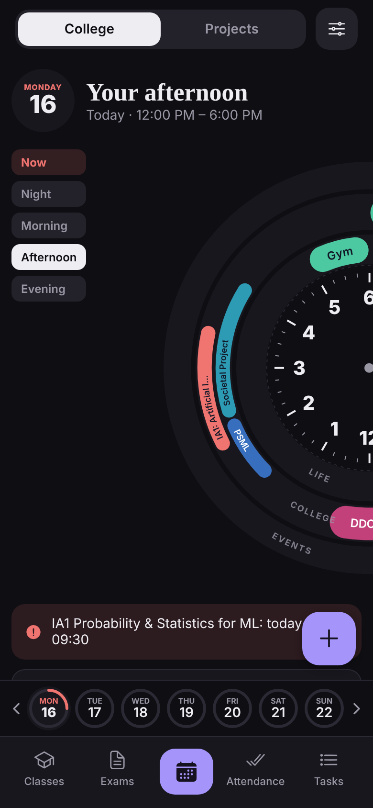<br/>Calendar: afternoon | 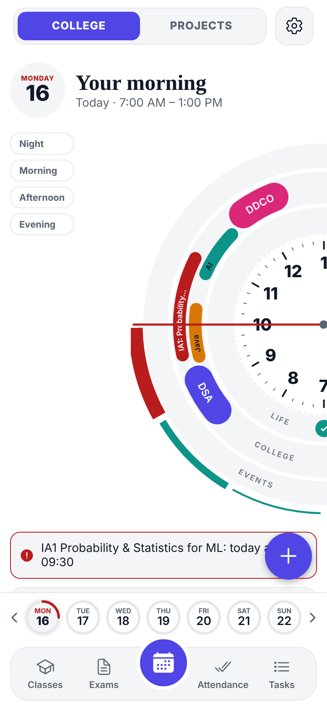<br/>Light theme |
| <br/>Classes | 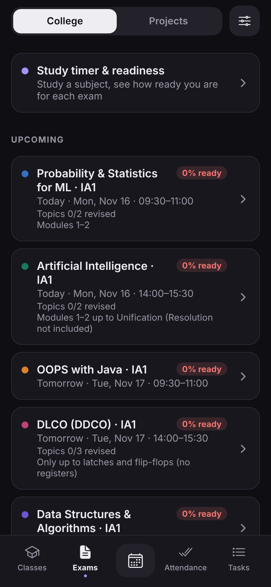<br/>Exams & clashes | 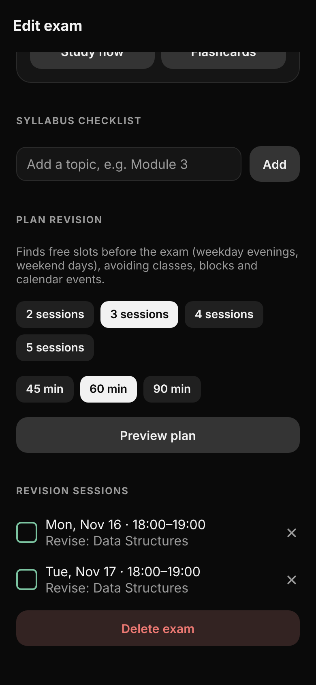<br/>Revision planner |
| 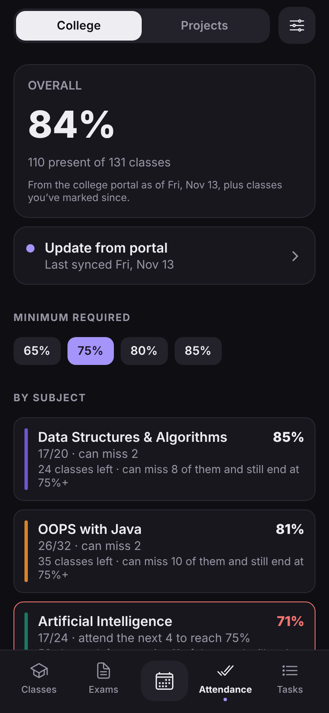<br/>Attendance | 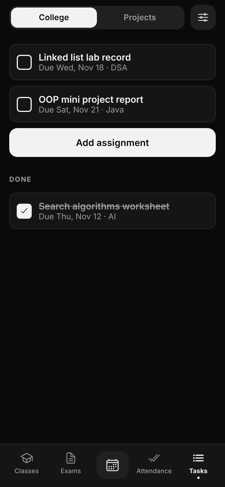<br/>Tasks | 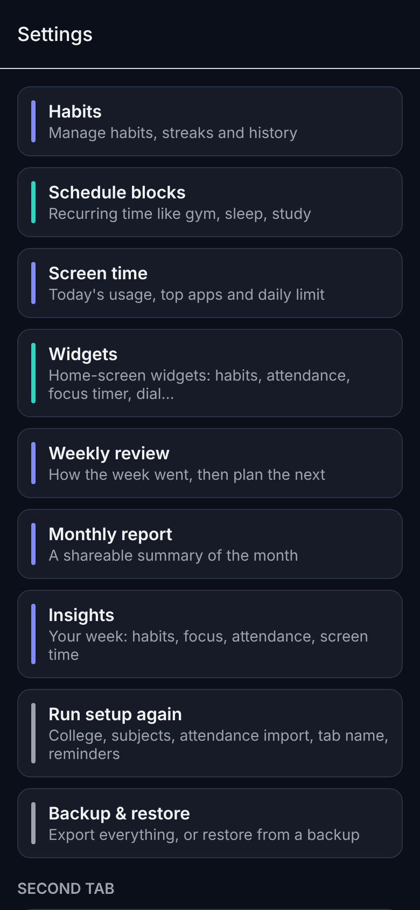<br/>⚙ hub & settings |
| <br/>Projects | 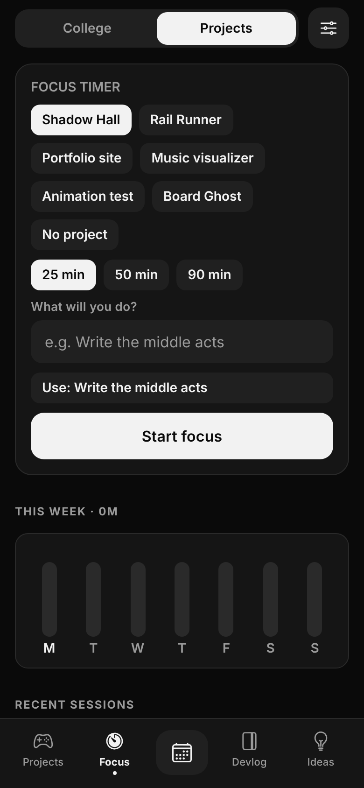<br/>Focus timer | 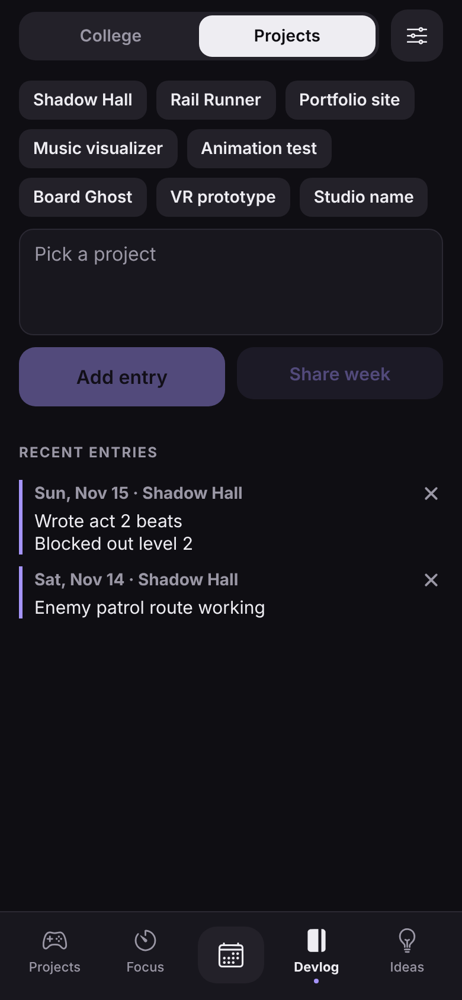<br/>Devlog |
| 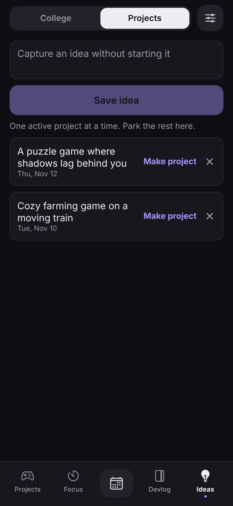<br/>Ideas inbox | 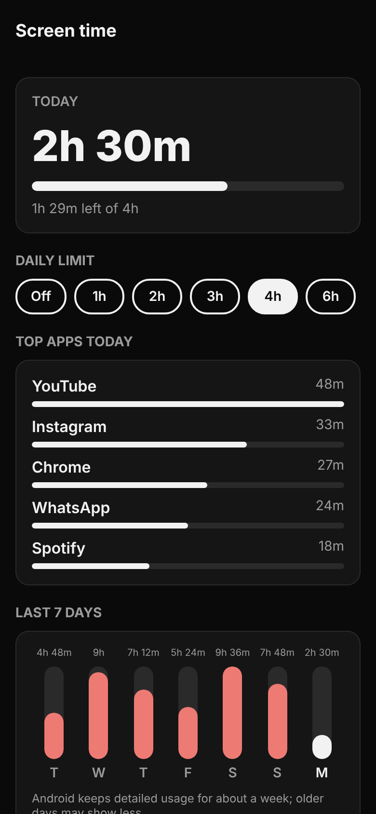<br/>Screen time | 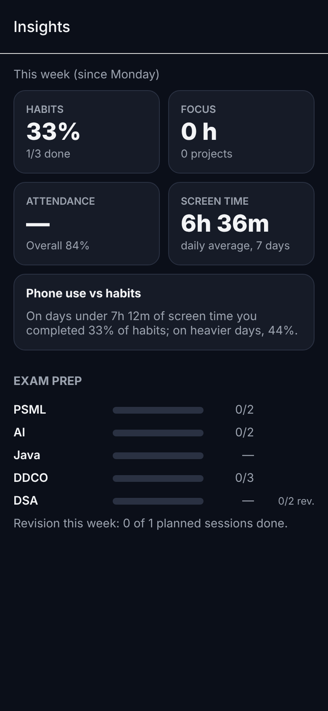<br/>Insights |
| 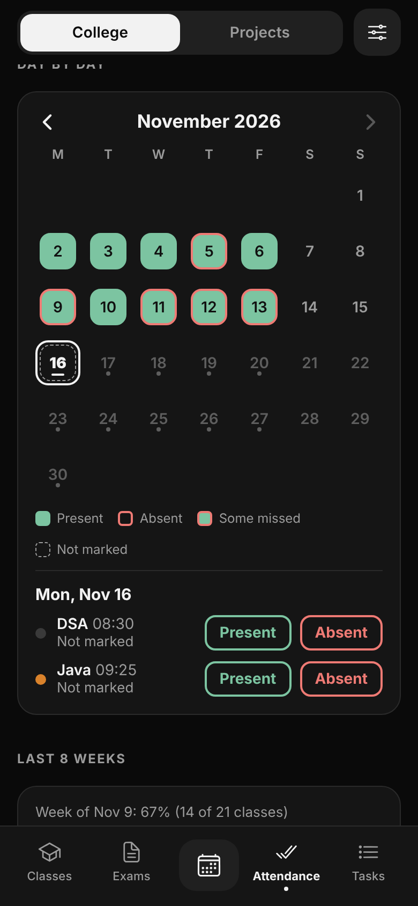<br/>Attendance day by day | 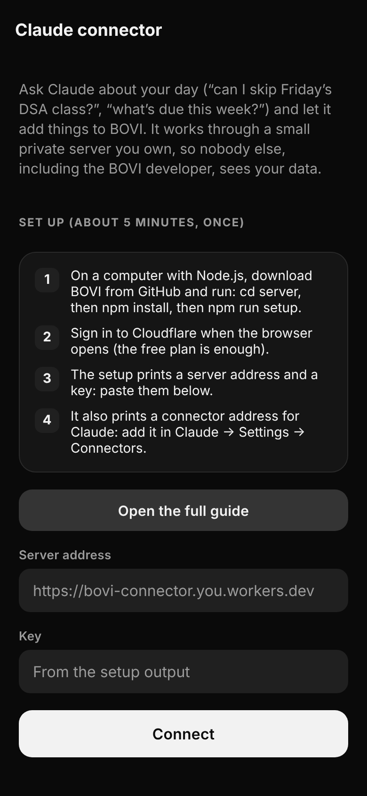<br/>Claude connector | <br/>Attendance import |

---

## Install on your Android phone

BOVI is built on your PC with Android's own tools and installed over USB. No Expo account, no store, nothing uploaded.

### One-time setup (PC)

1. Install **[Android Studio](https://developer.android.com/studio)** (bundles the Android SDK and a Java runtime) and **[Node.js](https://nodejs.org) 20+**.
2. Keep the project in a **short path**, e.g. `C:\dev\habit`.
3. Set environment variables (PowerShell; persists for your user):
   ```powershell
   $sdk = "$env:LOCALAPPDATA\Android\Sdk"
   [Environment]::SetEnvironmentVariable("ANDROID_HOME", $sdk, "User")
   [Environment]::SetEnvironmentVariable("JAVA_HOME", "C:\Program Files\Android\Android Studio\jbr", "User")
   $p = [Environment]::GetEnvironmentVariable("Path", "User")
   [Environment]::SetEnvironmentVariable("Path", "$p;$sdk\platform-tools", "User")
   ```
   Open a new PowerShell window afterwards.
4. **Windows only:** apply the long-path fixes in [Troubleshooting](#troubleshooting-the-windows-build) before the first build.

### One-time setup (phone)

1. *Settings → About phone →* tap **Build number** 7 times.
2. *Settings → System → Developer options →* turn on **USB debugging**.
3. Plug in with a data-capable cable and accept **"Allow USB debugging?"**.

### Build and install

```powershell
cd C:\dev\habit
git pull
npm install
npx expo prebuild --platform android     # needed after native changes (new modules/permissions/icons)
adb devices                              # phone should be listed as "device"
npm run install:phone                    # release build, installs on the phone
```

- The first build takes 10–20 minutes. Later ones take a few minutes.
- Updates install over the old version and **keep your data**.
- The APK is at `android/app/build/outputs/apk/release/app-release.apk`.
- After installing: allow **notifications**, then on the Calendar/Screen time screens allow **calendar** and **Usage access** when asked.
- **Motorola tip:** if reminders arrive late, set *Settings → Apps → BOVI → Battery* to **Unrestricted**.

---

## Troubleshooting the Windows build

| Symptom | Fix |
|---|---|
| `npm.ps1 cannot be loaded because running scripts is disabled` | `Set-ExecutionPolicy -Scope CurrentUser -ExecutionPolicy RemoteSigned` (or use `npm.cmd`). |
| `adb` is not recognized | Add `%LOCALAPPDATA%\Android\Sdk\platform-tools` to `PATH` (setup step 3) and open a new window. |
| `ninja: error: Stat(...): Filename longer than 260 characters` | 1) Enable long paths (admin PowerShell): `New-ItemProperty -Path "HKLM:\SYSTEM\CurrentControlSet\Control\FileSystem" -Name LongPathsEnabled -Value 1 -PropertyType DWORD -Force`. 2) Replace the SDK's old Ninja with a long-path-aware one (1.13.2), keeping a backup. See the script below. 3) Delete the stale C++ build folder: `cmd /c rd /s /q "\\?\C:\dev\habit\android\app\.cxx"`. |
| `git pull` refuses ("local changes would be overwritten") | `git checkout -- package.json package-lock.json` then `git pull` (these only change when `npm install`/prebuild runs). |
| Phone still shows the old app | Check `git log -1 --oneline` matches the latest commit, and that the build printed `BUILD SUCCESSFUL`. |

<details>
<summary>Ninja replacement script (one time)</summary>

```powershell
$ErrorActionPreference = "Stop"
$sdkNinja = "$env:LOCALAPPDATA\Android\Sdk\cmake\3.22.1\bin\ninja.exe"
if (-not (Test-Path "$sdkNinja.orig")) { Copy-Item $sdkNinja "$sdkNinja.orig" }
$info = Invoke-RestMethod "https://pypi.org/pypi/ninja/1.13.2/json"
$url  = ($info.urls | Where-Object { $_.filename -like "*win_amd64.whl" } | Select-Object -First 1).url
$tmp  = Join-Path $env:TEMP "ninja-new"; Remove-Item -Recurse -Force $tmp -ErrorAction SilentlyContinue
New-Item -ItemType Directory $tmp | Out-Null
Invoke-WebRequest $url -OutFile "$tmp\ninja.zip"; Expand-Archive "$tmp\ninja.zip" -DestinationPath "$tmp\x"
Copy-Item (Get-ChildItem "$tmp\x" -Recurse -Filter ninja.exe | Select-Object -First 1).FullName $sdkNinja -Force
& $sdkNinja --version   # 1.13.2
```
To undo: copy `ninja.exe.orig` back over `ninja.exe`.
</details>

---

## Development

```bash
npm install
npm start                 # dev server (press w for web; native modules are Android-only)
npm test                  # Jest unit tests (domain logic)
npm run typecheck         # TypeScript
npm run lint              # ESLint (expo config)
npx expo export --platform web   # static web build (used for browser tests/screenshots)
```

| Script | Purpose |
|---|---|
| `npm start` | Expo dev server |
| `npm test` | Jest unit tests |
| `npm run typecheck` | `tsc --noEmit` |
| `npm run lint` | `expo lint` |
| `npm run install:phone` | Release build + install on the USB-connected phone |

**Testing approach**
- All scheduling, attendance, streak, revision-planning, layout and reminder logic lives in pure functions in `src/lib/` with Jest tests.
- Screens were exercised in the web build with Playwright.
- Native pieces (screen time, widget, notifications, device calendar) need a phone to verify.

---

## Project structure

```
src/
  app/                      Expo Router routes
    (tabs)/                 index (calendar), classes, exams, attendance, tasks, projects, focus, devlog, ideas
    college/                class change, extra class, timetable, subjects, exam & assignment editors, marks, events…
    habit/ schedule/ project/   editors
    settings.tsx habits.tsx screen-time.tsx insights.tsx backup.tsx add.tsx history.tsx
  components/               TopBar, BottomBar, RadialDay, DayRings, FocusTimer, ui kit…
  hooks/                    Stores (habits, college, projects, settings) + sync hooks (reminders, widget)
  lib/                      Pure domain logic + tests (college, schedule, timeline, radial, studyPlan, …)
  lib/__fixtures__/demo.ts  Fictional demo data used only by tests (never shipped in the app)
  theme/                    Colours (WCAG AA), contrast helpers
modules/
  screen-time/              Local Expo module (Kotlin): Android UsageStatsManager → per-app foreground time
  bovi-widget/              Local Expo module (Kotlin): 10 home-screen widgets (RemoteViews), action queue, bitmaps
assets/                     Icon, adaptive icon layers, splash
docs/screenshots/           README screenshots
```

**Tech notes**
- Expo SDK 58, React Native 0.88 (New Architecture), Expo Router (typed routes), TypeScript strict.
- Native libraries: `expo-notifications`, `expo-calendar`, `expo-splash-screen`, `expo-system-ui`, `react-native-svg` (pinned to the SDK's version), `@react-native-async-storage/async-storage` v3.
- The `android/` folder is generated (Continuous Native Generation). Configure native behaviour in `app.json` or the local modules, never by hand.
- The Android package id is `com.bovi.app`; keep it unchanged so updates keep existing data.

---

## Data and privacy

- **Everything stays on the phone** (AsyncStorage). No accounts, no analytics, and no network calls, unless you set up the optional [Claude connector](docs/claude-connector.md). That sends a summary to a server you own and nobody else.
- Calendar events are read from the phone, and usage stats come from Android. Neither is copied anywhere.
- Back up with *⚙ → Backup & restore* if you change phones or reinstall.

---

## Known limitations

- **Android only for native features.** The web build has no screen time, widget, notifications or device calendar.
- **Daily screen-time limit:** an in-app warning only, with no notification when you cross it.
- **Widget timing:** widgets redraw at class boundaries and every 30 minutes. Android may delay these redraws by a few minutes to save battery. Opening BOVI refreshes them immediately.
- **Widget taps are saved when BOVI runs:** a tick or check-in shows on the widget right away, but reminders and insights only see it after you next open the app.
- **Usage history:** Android keeps detailed usage for about a week, so older days may show less screen time.
